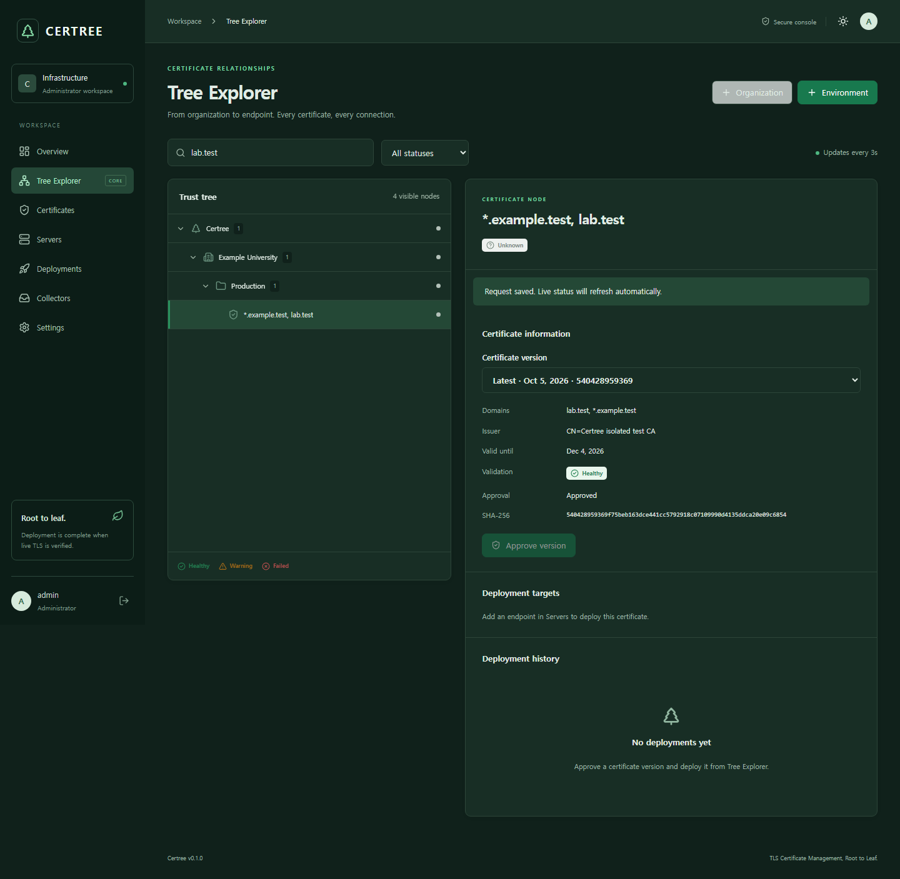

# Certree

**TLS Certificate Management, Root to Leaf.**

Certree is an open-source TLS certificate lifecycle manager for infrastructure that receives certificate bundles and deploys them to Nginx. It collects, validates, stores, deploys, and checks the certificate actually served by a TLS endpoint.

**v0.1.0 release candidate:** the application and local API/browser tests run. The real Nginx/OpenSSH Docker integration suite is provided but has not yet been executed on the development machine. Complete that release gate before using this candidate on production infrastructure. See [verification results](docs/VERIFICATION.md).

## Why Certree?

Certificate issuance is not certificate deployment. File replacement and reload are not proof of activation. Certree only marks a job successful after a trusted TLS handshake, hostname validation, and an exact SHA-256 leaf fingerprint match.

## Features

- Administrator login, password rotation, bcrypt hashing, bounded login attempts, expiring HttpOnly sessions, Secure cookies, and CSRF checks.
- Organizations and environments, a searchable tree, status filters, keyboard navigation, virtualized rows, selection details, and light/dark themes.
- Content-based PEM/DER certificate and key parsing, PFX/P12 passwords, bounded ZIP bundles, duplicate detection, immutable versions, and comparisons.
- X.509 lifetime, SAN/hostname, chain/trust, and private-key matching validation. Invalid or unapproved versions cannot deploy.
- Encrypted private keys, SSH credentials, and IMAP passwords using AES-256-GCM; metadata APIs never return secrets.
- Public-key SSH with mandatory pinned host identities. Nginx deployment uses restricted staging, backups, atomic per-file replacement, configuration testing, reload, and live TLS verification.
- Persistent deployment/verification jobs, per-server concurrency exclusion, verification backoff, interrupted deployment recovery, rollback results, and audit history.
- TLS IMAP collection, attachment inspection, UID/UIDVALIDITY deduplication, bounded polling retries, and mandatory administrator approval.
- Five-minute live verification of known active versions. Expiration status is evaluated when the inventory tree is read.

## Tree-Based Management

```text
Certree
└── Organization
    └── Environment
        └── Certificate
            ├── Nginx service endpoint · Healthy
            └── Nginx service endpoint · Failed
```

The tree is a projection of relational entities. Servers and certificates connect through service endpoints and deployment targets. A server can host several certificates, and a certificate can connect to several servers. Node IDs remain stable. Parent details report descendant counts, including certificate-level validation/expiration warnings; upper-level bulk deployment is a read-only preview.

## Architecture

```text
Browser → HTTPS reverse proxy → Go REST API → SQLite (WAL)
                                  ├── upload / TLS IMAP collectors
                                  ├── X.509 validation + encrypted secrets
                                  ├── persistent worker → SSH/SFTP → Nginx
                                  └── independent live TLS verification
```

React, TypeScript, Vite, Tailwind, TanStack Query, React Router, and Lucide power the console. Go standard `net/http`, `crypto/x509`, and `crypto/tls` handle the API and trust checks. SQLite uses the pure-Go modernc driver. Collector, Deployer, and Verifier are separate interfaces; v0.1 uses in-process adapters. Details: [architecture](docs/ARCHITECTURE.md), [OpenAPI 3.1](docs/openapi.json).

## Screenshots

Captured from the running application using locally generated test certificates. These are test inventory records, not production deployment evidence.




## Quick Start

Requires Docker Engine with Compose v2. Generate installation secrets with Go 1.27:

```sh
go run ./cmd/setup
docker compose up -d --build
```

The setup command creates a restricted `.env` with a random encryption master key and random initial administrator password. It refuses to overwrite existing configuration. Read the initial username/password from `.env`, then open **https://localhost:8443**. Change the password in Settings. The bootstrap password is ignored once the user exists.

The bundled Caddy proxy issues a local certificate using its internal CA. Export and trust its public root in your browser/OS through your usual local CA trust procedure:

```sh
docker compose cp proxy:/data/caddy/pki/authorities/local/root.crt ./certree-local-root.crt
```

For an internal organizational hostname, update `CERTREE_ORIGIN` and the Caddyfile together and provision a certificate trusted by your administrators. The default published port binds **127.0.0.1**, and the API container exposes no host port. Database data and Caddy trust state use persistent volumes. Back up the master key separately; losing it makes stored secrets unrecoverable.

Create an organization/environment in Tree Explorer, upload a bundle in Certificates, review and approve its version in Tree Explorer, register a server, add a deployment target, then deploy from its detail panel. Configure operator-controlled additional trust roots using `CERTREE_TRUST_BUNDLE` and a read-only mounted PEM file; uploaded CA certificates never automatically become trusted roots.

### Local development

Go 1.27 and Node.js 26 are supported. On Windows:

```powershell
powershell -ExecutionPolicy Bypass -File scripts/dev.ps1
```

On Linux:

```sh
sh scripts/dev.sh
```

Use `go run ./cmd/setup -dev -out .env.dev` when configuring manually. Development helpers use `.env.dev` and `data/dev.db` separately from Docker configuration. Development HTTP requires an explicit opt-in and a loopback listener. Docker installations always use Secure cookies. The Windows helper keeps dependency caches inside the project. For Vite HMR on port 5173, set the API's `CERTREE_ORIGIN` to `http://127.0.0.1:5173` and run the frontend with `npm run dev`.

## Security

Read [SECURITY.md](SECURITY.md) and the [threat model](docs/SECURITY.md) before connecting servers. Use dedicated SSH accounts and restrict writable paths and Nginx commands. Verify host keys independently; key collection alone does not establish trust. Certree does not provide issuance, OCSP/CRL revocation checks, RBAC, or unattended email-based approval.

Only one Certree process may own a database. v0.1 has no HA or distributed worker support. Backups contain remote private keys in mode-0600 files within mode-0700 directories; apply disk encryption and your organization's retention policy. Review a deployment target's external verification host independently from its SSH host.

## Supported Platforms

The management service runs on Linux (Docker) and Windows for local development. Deployment targets must be POSIX Nginx hosts with OpenSSH/SFTP support for `posix-rename@openssh.com` and `fsync@openssh.com`. Existing certificate/key/configuration files must be readable, destination directories writable, private keys restricted, and paths free of symlink ancestors. Configure a service account with narrowly scoped reload/test privileges if necessary. See [deployment operations](docs/OPERATIONS.md).

IMAP uses implicit TLS and reads the newest 100 matching messages from the preceding 30 days per poll. Email import requires a complete valid bundle with one matching private key; certificate-only renewals require manual combining with the key. Password-protected email PKCS#12 attachments require manual import with a password. Polling is serialized with other background work; manually requested polls run on the next worker poll, normally within a minute.

## Testing

```sh
go test ./...
go vet ./...
cd apps/web && npm ci && npm test && npm run build
```

Browser tests use a real compiled API, temporary SQLite database, and generated CA:

```sh
mkdir -p .cache
go build -o .cache/certree ./apps/server # Windows: .cache/certree.exe
go run ./cmd/lab -generate .cache/lab
cd apps/web
npx playwright install chromium
npm run e2e
```

Real Nginx, SSH/SFTP, local SMTP, and TLS IMAP integration tests:

```sh
docker compose -f compose.lab.yaml up --build --abort-on-container-exit --exit-code-from tests tests
docker compose -f compose.lab.yaml down -v
```

The lab publishes no host ports, generates its own disposable CA/keys, and requires no external mail or production servers. The second command deliberately deletes only disposable lab volumes. Unit tests use explicit deployer doubles for worker failure transitions and real TLS sockets for activation results. The integration suite uses real Nginx/OpenSSH and intentional failure injection. See [testing](docs/TESTING.md).

## Roadmap

See [ROADMAP.md](ROADMAP.md). Apache, Tomcat, WebtoB, IIS, HAProxy, ACME, Kubernetes, RBAC, PostgreSQL, and complex bulk policies are future work.

## Contributing

Start with [CONTRIBUTING.md](CONTRIBUTING.md). CI runs Go tests/vet/race, frontend tests/build, Chromium workflows, dependency and secret scans, and Docker integration tests. Proposed changes must preserve explicit approval and live TLS verification. [Release notes](CHANGELOG.md) describe the current candidate.

## License

Apache License 2.0. See [LICENSE](LICENSE) and [third-party notices](docs/THIRD_PARTY_NOTICES.md).
