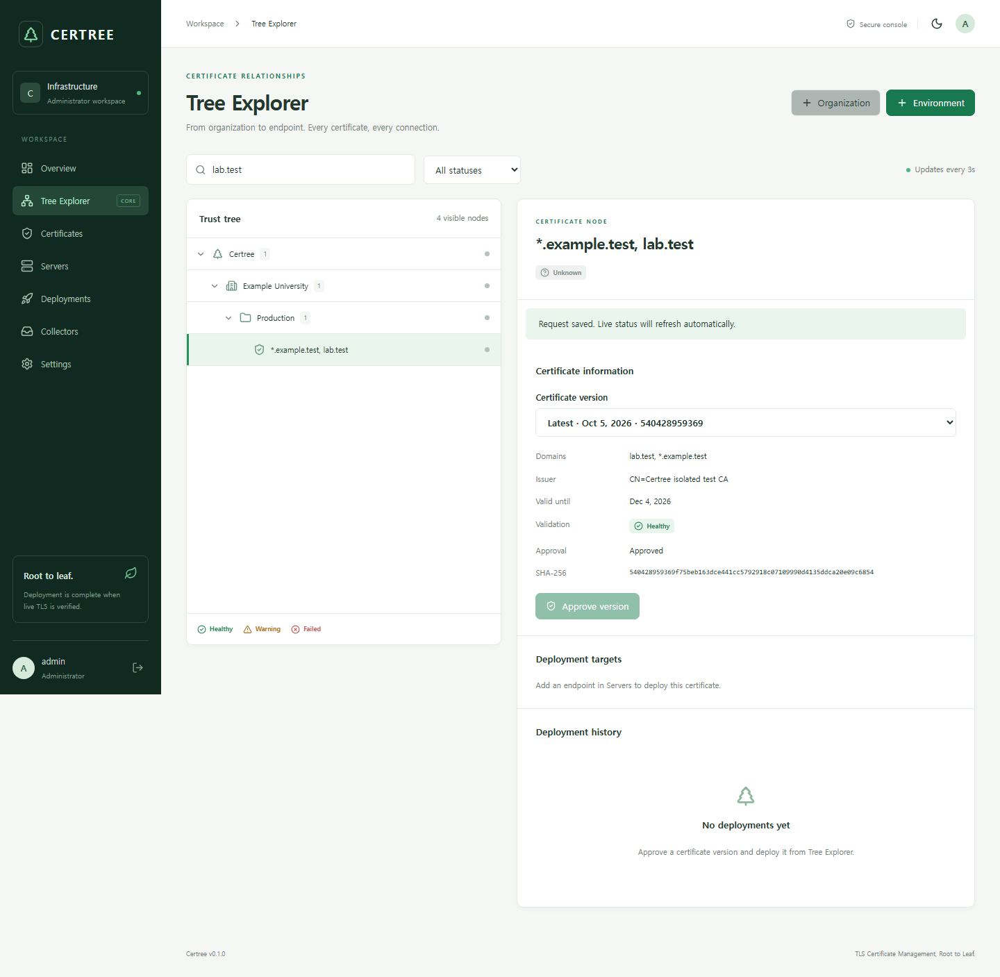
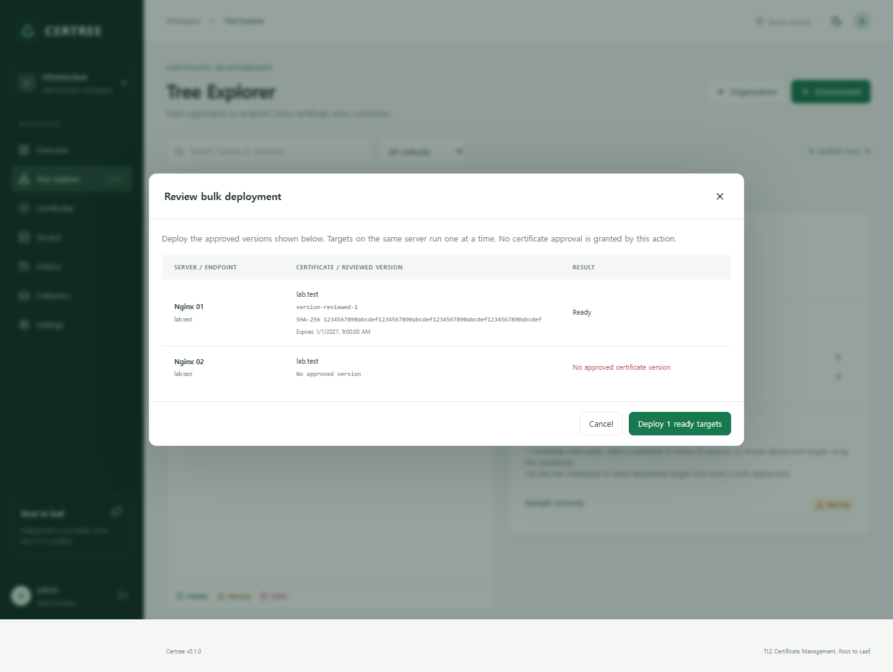

# Certree

**Self-hosted TLS certificate deployment with proof of activation.**

Certree helps infrastructure operators take an externally issued certificate bundle
from import and approval to Nginx deployment, then verify the certificate actually
served by the endpoint. It brings certificate inventory, server relationships,
expiry visibility and deployment evidence into one console.

[한국어](README.ko.md) · [Getting started](docs/GETTING_STARTED.md) ·
[Operations](docs/OPERATIONS.md) · [Client agent](docs/AGENT.md) ·
[Contributing](CONTRIBUTING.md) · [Security](SECURITY.md)

**Status:** v0.1.0 candidate; the outbound Linux agent is a development preview.
Source, test fixtures and CI definitions are available. Real Linux Nginx/systemd,
Docker integration and release/security gates remain to be completed and recorded.
See the dated [verification report](docs/VERIFICATION.md) for what actually ran.

## The problem

Issuing a certificate does not ensure every server is using it. Teams that receive
PEM or PKCS#12 bundles still need to associate them with the correct endpoints,
review their trust and key pair, replace files, reload the service, and check the
result. A successful copy or reload can leave a stale certificate serving traffic.

Certree treats a trusted TLS handshake, hostname validation and an exact SHA-256
leaf fingerprint match as the final deployment check. Failed deployment and
recovery results stay visible instead of being collapsed into a successful reload.

## Who it is for

- Operators managing Nginx endpoints on Linux and certificates issued elsewhere.
- Teams that need an explicit approval step and a record of what was deployed.
- Contributors exploring reproducible certificate deployment and recovery tests.

The first adapter is Nginx. Certree does not issue certificates, replace an ACME
client, or currently support Apache, IIS, Tomcat, HAProxy or Kubernetes adapters.
It is a single-administrator, single-process application in this candidate.

## What is implemented

| Area | Current behavior |
| --- | --- |
| Inventory | Organizations → environments → certificates → server endpoints, searchable tree, status filters and keyboard navigation |
| Bundle validation | Content-based PEM/DER/PKCS#12/bounded ZIP parsing, key matching, hostname, validity and operator-controlled trust checks |
| Approval and versions | Immutable certificate versions; explicit approval required before deployment |
| Deployment | Pinned SSH/SFTP or an outbound HTTPS Linux agent; Nginx configuration test, reload, restricted backups and recovery |
| Bulk operations | Filtered tree checkboxes, reviewed concrete approved versions, per-target results and durable per-server queues; up to 200 targets per batch |
| Expiry | Remaining days and lifetime bars based on the last verified applied certificate; server summaries show the earliest known expiry and unknown/undeployed counts |
| History | Separate Verification and Deployments views with server filtering and detailed job evidence; Verification is the default |
| Collection | TLS IMAP attachment import with deduplication and mandatory administrator approval |
| Monitoring | Live verification of known active versions every five minutes; this creates verification jobs, not recurring deployments |
| Installation updates | Capture an existing Compose installation and rebuild only the application while retaining its DB, key, trust mounts and project identity |

Private keys, SSH credentials and mailbox passwords are encrypted at rest using
AES-256-GCM. Administrator sessions use password hashing, bounded login attempts,
HttpOnly cookies and Origin/CSRF checks. These controls have documented limits;
read the [threat model](docs/SECURITY.md) before connecting real infrastructure.

## Preview

The Tree Explorer below uses generated local test inventory. The bulk-review
screenshot uses simulated API fixtures to demonstrate ready and blocked targets;
it is UI evidence, not proof of a production deployment.





## Try it locally

For a new installation, use Docker Engine with Compose v2 and the Go version in
[go.mod](go.mod). Building the container handles the frontend dependencies.

```sh
git clone https://github.com/polarbear138/certree.git
cd certree
go run ./cmd/setup
docker compose up -d --build
docker compose ps
```

Open **https://localhost:8443** on the installation host. Setup writes the initial
administrator credentials and a random encryption key to a mode-0600 `.env`; it
refuses to overwrite an existing file. Read that file locally, sign in and change
the password in Settings. Existing databases retain their existing account.

The bundled Caddy proxy uses a local CA. Export its **public root certificate**
and trust it using your workstation's normal certificate-management process:

```sh
docker compose cp proxy:/data/caddy/pki/authorities/local/root.crt ./certree-local-root.crt
```

The default listener is **127.0.0.1:8443**, so a remote PC cannot reach it directly.
For a Linux server accessed from another machine, use the [remote-access setup and
troubleshooting guide](docs/GETTING_STARTED.md#remote-access). Preserve the existing
DB volume and encryption key when upgrading an installation.

For the first workflow: create an organization/environment, import a bundle,
review and approve a version, register a server/target, deploy, then inspect live
TLS results. The [walkthrough](docs/GETTING_STARTED.md#first-certificate-workflow)
explains which endpoint must be reachable and which CA the management server trusts.

## Update an existing installation

Run this from the new source checkout once, using your existing **application**
container name:

```sh
sh scripts/update.sh --container certree-certree-1
```

A two-server test installation may instead use
`certree-two-server-test-certree-1`. The tool saves a restricted installation
profile, pins the existing database mount, builds first and then replaces only the
application. It preserves the proxy and refuses to create a missing DB volume.
Later updates from the same Git checkout use:

```sh
sh scripts/update.sh --pull
```

This pulls with `--ff-only` and rebuilds the app. A source pull alone does not
replace a running Docker image. Read [ZIP-to-Git migration, backup requirements
and update limits](docs/UPDATING.md); keep any original directories that provide
bind-mounted CA/configuration files.

## Architecture and boundaries

```text
Browser → HTTPS proxy → Go REST API → SQLite (WAL)
                          ├── certificate import / TLS IMAP
                          ├── X.509 validation + encrypted secrets
                          ├── durable per-server deployment queue
                          │     ├── pinned SSH/SFTP → Nginx
                          │     └── outbound HTTPS agent → local Nginx
                          └── independent live TLS verification
```

The console uses React and TypeScript. Go supplies HTTP, X.509 and TLS handling;
SQLite stores inventory, jobs and audit evidence. The application does not require
an OpenAI account or API key to run. Codex assists development and maintenance;
certificate approval and execution decisions remain explicit application checks.
See [architecture](docs/ARCHITECTURE.md) and [OpenAPI](docs/openapi.json).

Current limits include no RBAC, HA, distributed worker ownership, OCSP/CRL checks,
automatic secret rotation or remote backup retention. File replacement is atomic
per file, not across the certificate/key pair. A sampled TLS handshake does not
establish that every load-balancer backend is updated. See [operations](docs/OPERATIONS.md)
and [security](SECURITY.md) for the complete operating assumptions.

## Develop and verify

Use Go as pinned in `go.mod`, Node.js 26 and Python 3 for update-tool tests.

```sh
go test ./...
go vet ./...
python3 -m unittest discover -s tests -p test_update.py
node scripts/validate-openapi.mjs
cd apps/web
npm ci
npm test
npm run lint
npm run build
```

Browser workflows, the real Nginx/OpenSSH/mail lab, agent integration and Linux
race checks are documented in [testing](docs/TESTING.md). The workflow file
[defines CI gates](.github/workflows/ci.yml); a defined gate is not evidence of a
successful run. Dated outcomes and environmental blocks belong in
[VERIFICATION.md](docs/VERIFICATION.md), tied to the revision under review.

For local development use `sh scripts/dev.sh` on Linux, or
`powershell -ExecutionPolicy Bypass -File scripts/dev.ps1` on Windows. Both use
separate development configuration and data. See the [contributor guide](CONTRIBUTING.md).

## Contribute and maintain

Useful contributions include Linux integration evidence, recovery regressions,
installation documentation, accessibility and scoped adapter work. Start with
[CONTRIBUTING.md](CONTRIBUTING.md), report ordinary bugs through
[GitHub Issues](https://github.com/polarbear138/certree/issues), and follow
[SECURITY.md](SECURITY.md) for sensitive findings.

The [maintenance guide](docs/MAINTAINING.md) explains triage, review, evidence and
release practices. The [roadmap](ROADMAP.md) separates implemented work from
planned work and gives observable completion criteria. No adoption counts,
independent audit, production SLA or successful external CI run are implied by
these documents.

## Documentation

| Need | Guide |
| --- | --- |
| First install, remote access and first deployment | [Getting started](docs/GETTING_STARTED.md) · [한국어 시작 가이드](docs/GETTING_STARTED.ko.md) |
| Connect an outbound Linux client | [Agent setup and operations](docs/AGENT.md) |
| Updates without changing storage identity | [Updating](docs/UPDATING.md) |
| Permissions, backups and recovery | [Operations](docs/OPERATIONS.md) |
| Security assumptions and private reporting | [Security policy](SECURITY.md) · [Threat model](docs/SECURITY.md) |
| Test commands and observed results | [Testing](docs/TESTING.md) · [Verification](docs/VERIFICATION.md) |
| Self-hosted CI checks and publishing scope | [CI/CD](docs/CI_CD.md) |
| Maintainer workflows and release gates | [Maintaining](docs/MAINTAINING.md) · [Changelog](CHANGELOG.md) |

## License

Apache License 2.0. See [LICENSE](LICENSE), [NOTICE](NOTICE) and
[third-party notices](docs/THIRD_PARTY_NOTICES.md).
